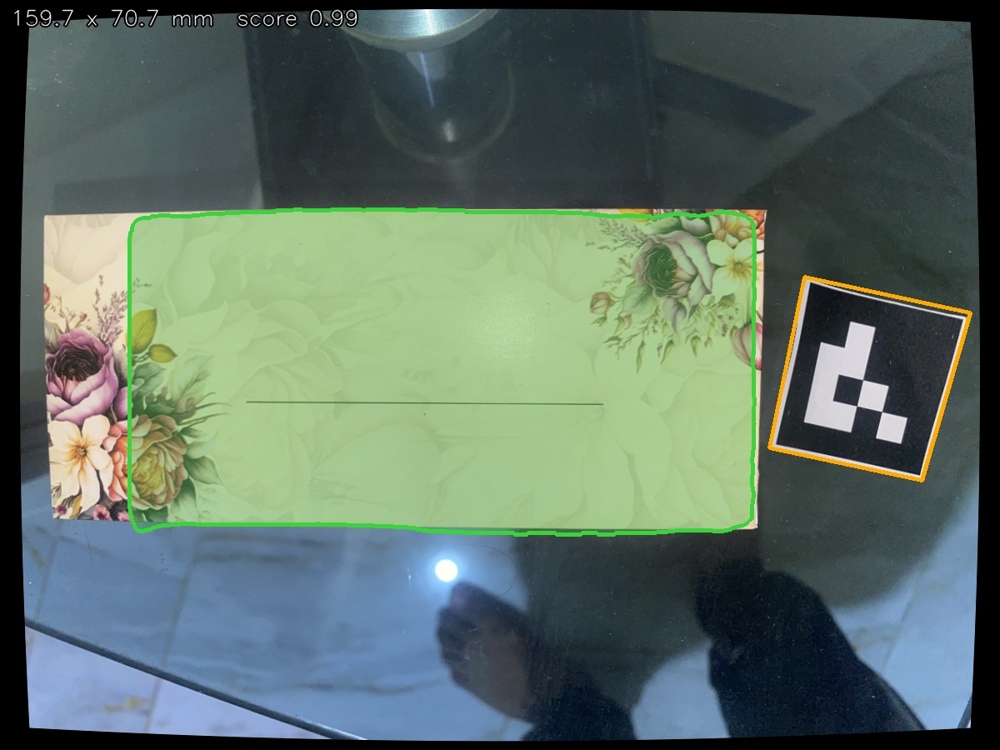

# Measure It

This project measures a flat envelope from an iPhone 11 Pro photo. The camera is corrected first, Mask R-CNN finds the envelope, and a measured square marker supplies the scale.

The five-epoch CPU run reached **0.929 mean mask IoU** on seven held-out photos. Against the reported 160 × 70 mm ruler reading, corrected test MAE is **16.32 mm long-side / 4.11 mm short-side**, so the 2 mm target was missed. All 70 photos show the same physical envelope. The saved example also shows why that check matters. Its confidence is 0.990 while part of the left edge is missing from the predicted mask.



## Run it

Use Python 3.12 from the root of this repository on branch `dev-test01`.

```sh
python -m pip install -r requirements.txt
python -m inference.measure my-envelope.HEIC --out measured.jpg
```

Before the second command, download [best.pth](https://github.com/Sherry-27/measure-it-envelopes/releases/download/envelope-model-v1/best.pth) into `models/runs/first/best.pth`. The full local project ZIP already has it there. Place the marker beside the envelope, keep both flat at the same height, and keep their whole outlines visible. The marker's measured outer black border is **36 × 36 mm**.

The command prints dimensions, confidence and status, and saves the overlay. It reads the original HEIC, reverses its display rotation and works in a 1200 × 900 sensor frame. It also accepts a JPEG in the documented sensor frame. An arbitrary crop has no known camera coordinates. To compare the same original without lens correction, add `--raw`.

For a photo picker and on-screen result, run:

```sh
python -m inference.desktop
```

Choose an original photo; the app displays the dimensions and saves an overlay plus JSON. The prepared Lenovo also has `Measure-Envelope.cmd` beside the full project ZIP: double-click it, then choose the photo. Keep both optional comparison boxes unchecked for the baseline demonstration. The app runs locally without the Codex chat.

## Data and reproduction

| Download | Contents |
| --- | --- |
| [Camera originals](https://github.com/Sherry-27/measure-it-envelopes/releases/download/envelope-model-v1/Camera-Originals-Sanitized.zip) | 70 HEIC files with GPS and maker-note metadata removed. Every decoded RGB pixel and the display orientation were verified unchanged. |
| [Prepared dataset](https://github.com/Sherry-27/measure-it-envelopes/releases/download/envelope-model-v1/Envelope-Dataset.zip) | 70 corrected JPEGs, 70 binary masks, the fixed split lists and reviewed outlines. Extract at the repository root. |
| [Test overlays](https://github.com/Sherry-27/measure-it-envelopes/releases/download/envelope-model-v1/Test-Result-Images.zip) | All seven held-out predictions with mask, dimensions, confidence and reviewed outline. |
| [Results video](https://github.com/Sherry-27/measure-it-envelopes/releases/download/envelope-model-v1/Envelope-Test-Results.mp4) | A 14-second view of the seven predictions. |

The three initial split lists have 49 training, 14 validation and 7 test filenames. The supplied photos did not follow the proposed ten per-envelope sessions. Original filenames and SHA-256 hashes were bound to those reserved slots before training. The actual scenes are recorded in [capture-index.csv](dataset/capture-index.csv).

- Training uses 20 checkerboard-and-envelope captures and 29 black-surface views.
- Validation contains five white, eight marble and one glass view. The glass view is excluded from every checkpoint and threshold decision.
- Test contains the other seven glass views. These are similar photographs on one surface. The capture was later confirmed to use the same physical envelope throughout; this is a new-view split, not an unseen-object test.

Labels started as colour and edge proposals. Every outline was inspected, with twenty manual boundary corrections. The saved polygons are in sensor coordinates, and the photo and mask use the same correction map. A rebuild from the originals reproduced all 140 training files byte-for-byte.

To recreate the camera fit and dataset, extract the camera-originals ZIP into a folder, then run:

```sh
python -m calibration.fit_iphone CAMERA_ORIGINALS
python -m dataset.restore CAMERA_ORIGINALS
python -m models.train --device cpu --out models/runs/reproduction
python -m models.evaluate --device cpu --weights models/runs/reproduction/best.pth --out models/reproduction-evidence
```

[The optional Colab notebook](https://colab.research.google.com/github/Sherry-27/measure-it-envelopes/blob/dev-test01/models/colab.ipynb) downloads the same prepared dataset, checks its hash, and runs the same five epochs on a GPU. Select a T4 runtime and run its cells once. The recorded results here came from the laptop.

## Camera, model and timing

The iPhone captures use the 4.25 mm rear lens at a native 4032 × 3024. OpenCV found all 63 board corners in twenty full-frame training views. The single-radial-coefficient fit has **1.035 px reprojection RMS**. Leaving a whole view out and checking alternate corners gave mean RMS **1.048 px corrected**, compared with **1.163 px** with zero distortion. The fit uses the rounded 26 mm-equivalent EXIF focal length as a prior. The board covered a limited region of the frame. A later ruler reading of 90 mm over five squares in each direction confirmed an average square size of 18 mm. The ruler division is 1 mm; a calliper was not used. [Camera parameters](calibration/parameters.json) · [Fit checks](calibration/evidence/fullframe-validation.json)

TorchVision Mask R-CNN starts with COCO-pretrained ResNet-50/FPN weights. The ResNet body is frozen. The FPN, proposal and prediction components fine-tune on the training masks. The run uses seed 2026, batch size 1, two CPU threads, small proposal batches and 256–384 px model inputs. Rotations and flips are applied only to training. Epoch 5 won validation selection at a score cutoff of 0.80. [Configuration](models/config.json) · [Epoch log](models/evidence/training.jsonl)

The laptop is an Intel Core i5-4300U with about 8 GB RAM, Intel HD Graphics and Windows 10. Five warm calls including HEIC decoding took a median **11.08 s**, with a range of **8.76–31.64 s**. Model loading and image writing are outside that timing. [Environment](models/evidence/environment.json) · [Timing output](measurement/evidence/capture-summary.json)

## Measurement and limits

`inference/measure.py` calls lens correction, segmentation and reference detection. In `inference/geometry.py`, the four marker corners establish a map into its measured plane. The envelope contour is transformed first, and a rotated rectangle is fitted in millimetres. The detection score describes model confidence. It does not estimate physical uncertainty.

The saved example reads **205.6 × 86.4 mm raw** and **159.7 × 70.7 mm corrected**, compared with the reported **160 × 70 mm** ruler reading. Its corrected errors are only **0.31 / 0.67 mm**, but that single result hides larger errors elsewhere.

| Photos / mode | Accepted | Long MAE | Short MAE | Long MAPE | Short MAPE |
| --- | ---: | ---: | ---: | ---: | ---: |
| All / raw | 66/70 | 15.32 mm | 4.77 mm | 9.57% | 6.81% |
| All / corrected | 68/70 | 19.50 mm | 5.06 mm | 12.19% | 7.23% |
| Same 66 / raw | 66/66 | 15.32 mm | 4.77 mm | 9.57% | 6.81% |
| Same 66 / corrected | 66/66 | 19.46 mm | 5.03 mm | 12.17% | 7.19% |
| Test 7 / raw | 7/7 | 23.25 mm | 6.53 mm | 14.53% | 9.33% |
| Test 7 / corrected | 7/7 | 16.32 mm | 4.11 mm | 10.20% | 5.87% |

The [70-row table](measurement/evidence/physical/instances.csv) includes every prediction, refusal, absolute error and percentage error. [The summary](measurement/evidence/physical/summary.json) includes medians and worst cases. The worst corrected long-side error is **121.32 mm**. High segmentation confidence does not prevent a bad physical estimate.

The ruler has 1 mm divisions. All rows reuse one confirmed specimen's hand reading, rather than claiming 70 independent objects. The original objective called for fresh photos of ten envelopes, which was not achieved. [Reading provenance](measurement/physical-readings.json)

Reproduce the recorded measurements and score them:

```sh
python -m measurement.audit_outputs CAMERA_ORIGINALS --weights models/runs/first/best.pth
python -m measurement.compare --table measurement/hand-readings.csv --predictions measurement/evidence/capture-results.csv
```

For a new ruler-measured set, fill [the template](measurement/hand-readings.template.csv) with the actual filenames and physical specimen IDs, then use `--photos YOUR_PHOTO_FOLDER` instead of `--predictions`.

## Failure and crop checks

Digital dimming of two validation photos reduced accepted measurements from 2/2 at full intensity to 0/2 at one-eighth intensity. This is a fixed-image lighting simulation, not a physical illumination experiment. [All levels](measurement/evidence/brightness/trials.csv) · [Preview](measurement/evidence/brightness/preview.jpg)

The requested automatic crop refinement was also tested. It corrects the whole image first, crops around the detected mask, runs a second segmentation pass, and restores the mask to the original camera coordinates. On 13 eligible validation views it worsened long/short MAE from **9.94/2.36 mm** to **13.95/6.68 mm**. It stays off by default. Its `--refine-crop` flag is available for reproducing that experiment. The original seven-image test scores were not rerun or replaced. [Crop results](measurement/evidence/crop/summary.json)

```sh
python -m measurement.brightness_test CAMERA_ORIGINALS
python -m measurement.crop_test CAMERA_ORIGINALS
```

For submission, record your own Loom of five minutes or less: take a fresh photo on camera, run it, measure both edges with a ruler, follow the code from image to millimetres, and answer all four brief questions without reading notes. The saved results video is supporting evidence.

The checkpoint SHA-256 is `62eace2421f7f6029d366ef2164942e17a3b39ad5f937fdfa1694d83da562b5f`. The release server and local file matched. [Verified assets](models/evidence/release-assets.json)

[Plan and decisions](docs/Plan.md) · [Objectives and raw results](docs/Objectives.md) · [Definition of Done](docs/Definition-of-Done.md)
